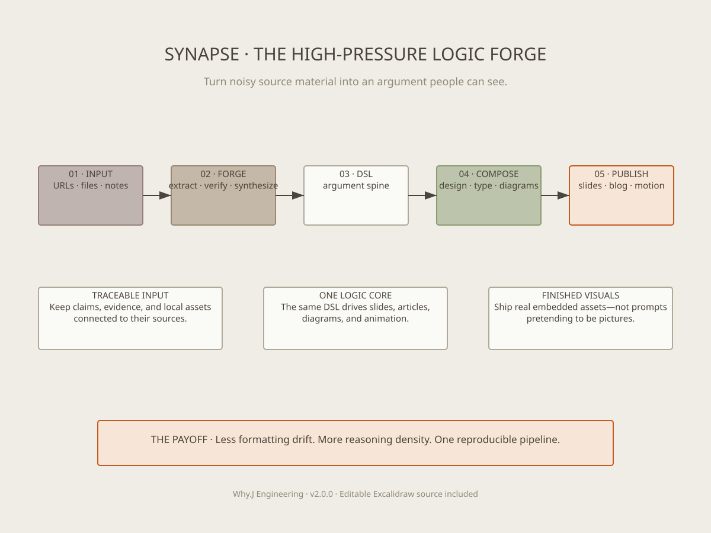

# Synapse

<div align="center">
  

  **The High-Pressure Logic Forge for AI-native technical publishing**

  把散乱的 URL、文件与笔记，锻造成可验证、可复用、可发布的技术叙事。

  [](https://github.com/yangjingo/Synapse/releases/tag/v2.0.0)
  [](LICENSE.txt)
</div>



Synapse 不是又一个“帮我总结”的提示词。它是一组可组合的 Codex Skills：先追溯证据、提炼论点，再用统一 DSL 生成 Slides、技术博客、Excalidraw 图和动画。输出保留本地素材、验证脚本与可编辑源文件，适合持续迭代，而不是一次性演示。

## 为什么使用 Synapse

- **先逻辑，后排版**：`synapse-forge` 把素材压成 argument spine，避免内容被模板牵着走。
- **同源多产物**：一份 DSL 可驱动 Slides、Blog、Diagram 与 Motion，减少跨格式漂移。
- **交付真实素材**：图片直接嵌入最终页面，同时保留 `.excalidraw` 源文件和自动校验。

## 安装

### 给 Human：交互式选择

```bash
npx --yes skills add https://github.com/yangjingo/Synapse \
  --agent codex --global --full-depth --copy
```

在列表中选择需要的 Skills；首次使用建议安装全部 6 个。

### 给 Agent：无交互安装

把下面这句话直接交给 Codex：

> Run `npx --yes skills add https://github.com/yangjingo/Synapse --agent codex --global --full-depth --copy --skill "*" --yes`, then verify that `synapse` and all five `synapse-*` skills are installed.

完整说明见 [Quickstart](docs/QUICKSTART.md)。

## 立即使用

安装后重启 Codex，然后直接描述目标：

```text
Use $synapse to turn these papers and notes into a Why.J-style slide deck
and engineering blog. Keep claims traceable and embed finished visuals.
```

也可以单独调用能力：

- `$synapse-forge`：URL / 文件 / 原始文本 → Slides 或 Blog DSL
- `$synapse-design`：叙事结构、视觉系统与 HTML Slides
- `$synapse-pretext`：零 DOM 文本测量与 Blog 排版
- `$synapse-excalidraw`：可编辑手绘技术图
- `$synapse-animation`：SVG / GIF / Remotion 技术动画

## 仓库导航

```text
SKILL.md                  # 主编排 Skill
skills/synapse-*/         # 五个独立能力模块
examples/                 # 可运行的完整交付样例
scripts/                  # 刷新与验证脚本
docs/                     # Quickstart 与项目说明
```

从 [examples](examples/) 看最终效果，从 [项目介绍](docs/PROJECT-INTRO-CN.md) 理解设计原则。README 流程图的可编辑源文件位于 [`docs/assets/diagrams`](docs/assets/diagrams/)。

## 开发与验证

```bash
node scripts/refresh-skill-examples.js
node scripts/validate-slide-visuals.js
node scripts/generate-readme-diagram.js
```

贡献前请阅读 [AGENTS.md](AGENTS.md)。

---

<div align="center"><strong>Why.J Engineering · Distill noise into logic.</strong></div>
