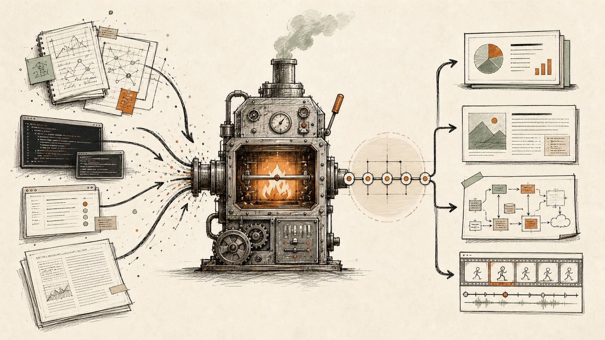

# Synapse

<div align="center">
  

  **面向 AI 原生技术出版的逻辑锻造炉。**

  [English](README.md) · [视觉介绍](docs/slides/index.html) · [快速开始](docs/QUICKSTART.md)
</div>



<div align="center"><sub>原始证据 → 逻辑锻造 → 单一论证主干 → SLIDES · 文章 · 图表 · 动画</sub></div>

Synapse 是一组可组合的 Codex Skills：像上图的锻造炉一样，把 URL、文件与原始笔记压缩成可追溯的单一论证主干，再从同一份 DSL 生成 Slides、技术文章、可编辑图表与动画。最终交付嵌入真实视觉素材，不把图片 Prompt 当成成品。

## 安装

Human 交互式安装：

```bash
npx --yes skills add https://github.com/yangjingo/Synapse \
  --agent codex --global --full-depth --copy
```

Agent 无交互安装：

```bash
npx --yes skills add https://github.com/yangjingo/Synapse \
  --agent codex --global --full-depth --copy --skill "*" --yes
```

安装后重启 Codex。验证与升级方式见 [QUICKSTART](docs/QUICKSTART.md)。

## 使用

```text
使用 $synapse，把这些论文和笔记做成 Why.J 风格的 Slides 与技术文章。
保留论点来源，并在最终页面嵌入真实图片。
```

[Notes](skills/synapse-notes/SKILL.md) 写感触随笔、记录个人成长。[技术博客](skills/synapse-tech-blog/SKILL.md) 写给同行，用可核验、可复用的工程判断建立技术影响力。公众号、Notion、Bearblog 等交付格式按需选择。

| Skill | 职责 |
|---|---|
| `$synapse-tech-blog` | 技术博客、论文解读、技术复盘与 Notion/Bearblog 交付 |
| `$synapse-notes` | 感触随笔、理解变化、读书观察和个人成长记录 |
| `$synapse-forge` | 素材 → 可验证的论证 DSL |
| `$synapse-design` | Slides 视觉规则与模板 |
| `$synapse-pretext` | 几何感知的文章排版 |
| `$synapse-excalidraw` | 可编辑技术图 |
| `$synapse-animation` | SVG、GIF 与 Remotion 动画 |

## 看实际产出

- [项目视觉介绍](docs/slides/index.html)
- [On-Policy Distillation](examples/opd/)
- [DeepSeek-V4](examples/deepseek-v4/)
- [CLI Revolution](examples/cli-revolution/)
- [Nano Claude Code](examples/nano-cc/)

贡献规范见 [AGENTS.md](AGENTS.md)。
